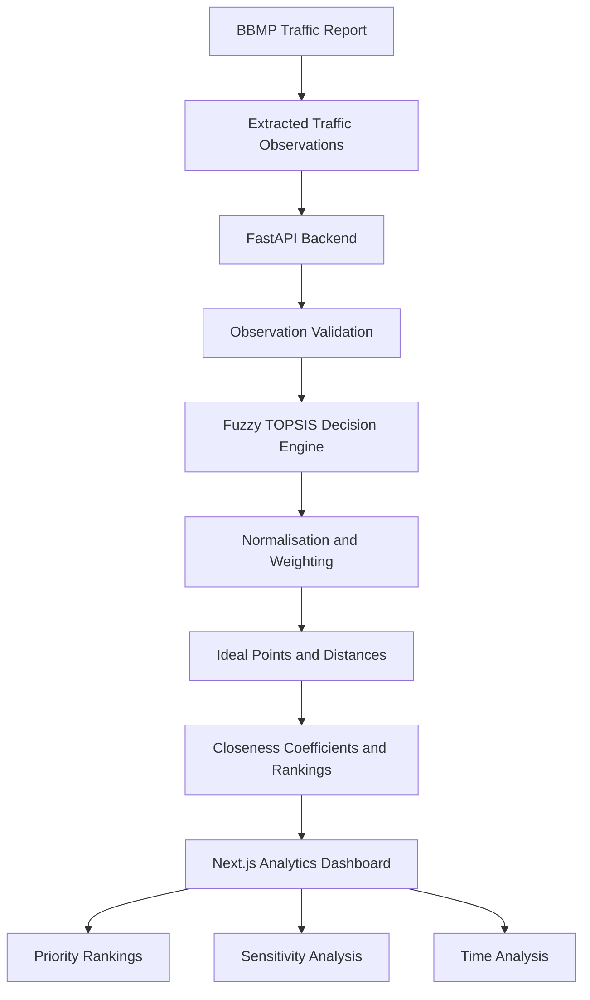

<div align="center">

# 🌍 MobilityForge

### Building Better Mobility Systems

**Turning urban traffic data into intelligent prioritisation decisions.**

An interactive urban mobility decision-support platform that uses a provisional Fuzzy TOPSIS framework to analyse traffic conditions and rank road-section alternatives.

<br/>


<br/>

**Data → Analysis → Prioritisation → Insight**

</div>

---

## 🛰️ The Vision

Cities don't just need more traffic data. They need better ways to interpret it.

Traffic volumes, road capacity, congestion levels, and peak-hour variations can make it difficult to decide which locations deserve attention first.

**MobilityForge explores how multi-criteria decision-making can make that process more structured, transparent, and explainable.**

Built around traffic observations from Bengaluru, the platform combines a web-based analytics interface with a Python decision engine to investigate how road-section priorities change under different traffic conditions and weighting assumptions.

> ⚠️ **Research status:** The decision engine is implemented, but its methodological conventions and weighting scenarios remain provisional. Its rankings do not establish the effectiveness of any traffic intervention.

---

## ✨ Explore MobilityForge

<table>
<tr>
<td width="50%" valign="top">

### 🚦 Traffic Intelligence

Explore source-derived traffic observations across six Tumkur Road sections.

- PCU traffic volumes
- Volume-to-capacity ratios
- Level of Service indicators
- Observation validation

</td>
<td width="50%" valign="top">

### 🧠 Decision Engine

Execute the implemented Fuzzy TOPSIS workflow using explicit criterion weights.

- Configurable weights
- Normalised criteria
- Ideal-point calculations
- Closeness coefficients
- Ranked alternatives

</td>
</tr>
<tr>
<td width="50%" valign="top">

### 📊 Sensitivity Analysis

Investigate how different weighting assumptions influence the resulting rankings.

- Five scenarios: S0–S4
- Scenario-specific coefficients
- Rank-order comparisons
- Transparent assumptions

</td>
<td width="50%" valign="top">

### ⏱️ Temporal Analysis

Compare traffic observations across different periods and directions.

- Morning versus evening
- Direction-specific comparisons
- Section-level filtering
- PCU, V/C, and LOS comparisons

</td>
</tr>
</table>

### 🎨 Designed for exploration

- Light and dark themes
- Collapsible navigation
- Responsive interface
- Consistent visual design
- Explicit validation and methodology disclosures

---

## 🏗️ System Architecture



### How the system works

**01 — Observe**

Load traffic observations containing PCU volumes, volume-to-capacity ratios, and LOS indicators.

**02 — Validate**

Check observations and reject invalid, duplicate, or mixed-run inputs where required by the implementation.

**03 — Configure**

Select a time period and direction, then provide explicit criterion weights.

**04 — Calculate**

Execute the provisional Fuzzy TOPSIS calculation pipeline.

**05 — Compare**

Inspect rankings, closeness coefficients, and the effects of alternative weighting scenarios.

**06 — Interpret**

Use the results as decision-support outputs while accounting for methodological and data limitations.

---

## 🧮 The Decision Framework

MobilityForge implements a multi-criteria ranking workflow inspired by Fuzzy TOPSIS.

| Stage | Purpose |
|---|---|
| Alternative selection | Select six road-section alternatives for one specific run |
| Criterion representation | Represent measured PCU and V/C values as singleton triangular fuzzy numbers |
| Normalisation | Transform criterion values using the implemented benefit/cost rules |
| Weighting | Apply explicitly supplied criterion weights |
| Ideal-point construction | Construct positive and negative ideals from the weighted matrix |
| Distance calculation | Calculate vertex distances from the ideal points |
| Closeness calculation | Calculate a closeness coefficient for each alternative |
| Ranking | Sort alternatives deterministically using the calculated results |

### 🔬 Sensitivity scenarios

The application implements five illustrative weighting scenarios.

| Scenario | PCU weight | V/C weight | Purpose |
|---|---:|---:|---|
| S0 | 0.50 | 0.50 | Equal weighting |
| S1 | 0.70 | 0.30 | Greater emphasis on PCU |
| S2 | 0.30 | 0.70 | Greater emphasis on V/C |
| S3 | 1.00 | 0.00 | PCU-only scenario |
| S4 | 0.00 | 1.00 | V/C-only scenario |

These scenarios are **illustrative and unapproved**. They are useful for exploring model behaviour, not evidence that any weighting scheme is scientifically optimal.

For the detailed methodological specification, see [`research/phase7_fuzzy_topsis_specification.md`](research/phase7_fuzzy_topsis_specification.md).

---

## 🛠️ Technology Stack

| Layer | Technologies |
|---|---|
| Frontend | Next.js, React, TypeScript |
| Styling | CSS, light/dark theme tokens, responsive layouts |
| Backend API | Python, FastAPI, Uvicorn |
| Data processing | Pandas, NumPy |
| Decision support | Fuzzy-number representation, TOPSIS calculations, sensitivity analysis |
| Testing | Pytest, frontend linting, production builds |
| Version control | Git, GitHub |

The exact Python dependencies are maintained in [`backend/requirements.txt`](backend/requirements.txt). Frontend dependency versions are recorded in [`frontend/package-lock.json`](frontend/package-lock.json).

---

## 🚀 Get Started

### Prerequisites

- Python and pip
- Node.js and npm
- The required BBMP source report and extracted CSV files

### 1. Clone the repository

```bash
git clone https://github.com/shaheeq27/Mobility-Forge.git
cd Mobility-Forge
```

### 2. Set up the backend

```bash
python3 -m venv .venv
source .venv/bin/activate

python -m pip install -r backend/requirements.txt
```

### 3. Start the API

From the repository root:

```bash
MOBILITY_FRONTEND_ORIGINS=http://localhost:3000 \
PYTHONPATH=backend \
python -m uvicorn api.main:app --reload --port 8000
```

The API runs at `http://localhost:8000`.

### 4. Set up the frontend

Open a second terminal:

```bash
cd frontend
npm ci
```

### 5. Launch MobilityForge

```bash
NEXT_PUBLIC_MOBILITY_API_URL=http://localhost:8000 npm run dev
```

Open **http://localhost:3000** in your browser.

### ⚙️ Configuration

| Variable | Purpose |
|---|---|
| `NEXT_PUBLIC_MOBILITY_API_URL` | Configures the API base URL used by the frontend |
| `MOBILITY_FRONTEND_ORIGINS` | Configures the frontend origins permitted by backend CORS |

---

## 🔌 API Reference

| Method | Endpoint | Description |
|---|---|---|
| `GET` | `/health` | Check backend service health |
| `GET` | `/observations` | Retrieve traffic observations |
| `GET` | `/observations/validation` | Validate available observations |
| `POST` | `/decision-engine/run` | Execute a decision run |

The decision endpoint requires explicit criterion weights and acknowledgement of the provisional methodology.

The API validates the requested period/direction selection and observation set before calculating rankings. See [`backend/README.md`](backend/README.md) and [`backend/api/main.py`](backend/api/main.py) for implementation details.

---

## 📂 Project Structure

```text
TrafficPriority-AI/
│
├── backend/
│   ├── api/                  # FastAPI routes and application
│   ├── mobility_engine/      # Decision execution service
│   ├── tests/                # Backend tests
│   ├── requirements.txt
│   └── README.md
│
├── frontend/
│   ├── src/
│   │   ├── app/              # Application pages and styling
│   │   ├── components/       # Shared UI components
│   │   └── lib/               # API integration and utilities
│   ├── package.json
│   └── README.md
│
├── research/
│   └── phase7_fuzzy_topsis_specification.md
│
├── data/                     # Local research data; excluded from Git
└── README.md
```

---

## 📊 Dataset and Reproducibility

The project uses traffic data from the **BBMP Comprehensive Bengaluru City Traffic Management Infrastructure Plan: Final Feasibility Report**, focusing on six Tumkur Road sections.

The source PDF and extracted CSV files are intentionally excluded from Git. They must be obtained separately and placed at their expected local paths before running data-dependent workflows.

Expected files:

```text
data/
├── raw/
│   └── bbmp-ctmp-tumkur-road-old-madras-road.pdf
└── extracted/
    ├── bbmp_tumkur_midblock_vc_los_table8.csv
    ├── bbmp_intersection_volume_table158.csv
    └── bbmp_tumkur_intersection_volume_table10.csv
```

A fresh clone does not contain these files automatically.

The current primary scope uses six road sections with morning/evening observations and two travel directions. Each period/direction combination is analysed independently; the model does not silently combine the four runs into one ranking.

---

## 🧪 Testing and Verification

Run the backend tests from the repository root:

```bash
source .venv/bin/activate
PYTHONPATH=backend python -m pytest backend/tests -q
```

Check Python compilation:

```bash
PYTHONPATH=backend python -m compileall -q backend
```

Run frontend lint and production build:

```bash
cd frontend
npm run lint
npm run build
```

Audit frontend dependencies:

```bash
npm audit --audit-level=moderate
```

The project previously passed its backend tests, Python compilation, frontend lint, production build, and dependency audit. Run the checks again in the current environment to verify the checkout.

The Next.js and `eslint-config-next` dependencies have been updated to version `16.4.1`.

---

## ⚖️ Research Integrity and Limitations

MobilityForge is a research prototype. Its outputs must be interpreted in light of the following limitations.

- **Provisional fuzzy representation:** Measured PCU and V/C values are currently represented as singleton triangular fuzzy numbers.
- **Unapproved weights:** S0–S4 are illustrative scenarios, not approved research weights.
- **Methodological conventions:** Weighted-matrix ideal points and additive aggregation of criterion distances are implementation choices requiring methodological approval.
- **Unresolved peak windows:** The exact Table 8 peak-time clock windows remain unresolved.
- **Related indicators:** LOS is used for interpretation and validation rather than as an independent primary criterion in the current design.
- **No intervention-effectiveness evaluation:** Ranking road sections does not prove that a proposed traffic intervention will reduce congestion.
- **No validated final conclusions:** Research findings must be established through appropriate validation and interpretation of reproducible outputs.

These limitations are documented to keep the distinction clear between implemented software behaviour and validated research conclusions.

---


---

<div align="center">

### 🌱 Building more transparent mobility decisions.

**MobilityForge — Building Better Mobility Systems**

*An urban mobility decision-support research prototype.*

</div>